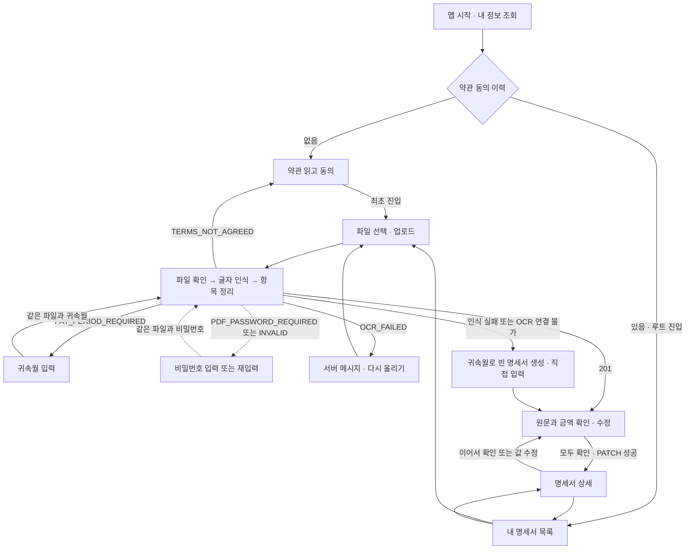

# 급여명세서 FE 설계

## 1. 목적과 범위

첫 급여명세서를 받은 사람이 파일 한 장을 올리고, 명세서의 원문 항목명과 인식한 금액을 대조한 뒤, 확인한 명세서를 다시 찾아볼 수 있게 한다. 데모에서 가장 중요한 순간은 식대처럼 이름이 다르게 적힌 항목을 이해하고 직접 고쳐 저장하는 순간이다.

범위는 약관 동의, 업로드, 14개 금액 확인·수정, 목록과 상세 조회다. 회원가입·로그인 화면, 프로필 입력, 세금 계산, 점검·할 일, 관리자 화면은 범위 밖이다. 브라우저는 Spring Boot BE만 호출한다.

**현재 데모의 저장 시점.** 업로드 성공 시 BE가 인식 결과를 미확인 명세서로 저장한다. 이후 사용자가 ‘모두 확인’을 누르면 BE가 값과 확인 여부를 갱신한다. 중간에 나가도 목록 → 상세 → ‘이어서 확인’으로 돌아올 수 있다. 현재 브랜치의 PDF 비밀번호 지원과 암호화 안내 조건은 7·10절에 기록했다.

## 2. 기술 선택

| 선택 | 이 화면에서의 역할 |
| --- | --- |
| React + Vite + TypeScript | 검색 노출이나 SSR이 필요 없는 SPA다. DTO의 nullable 금액을 타입으로 구분하고, BE가 허용하는 5173 포트에서 개발한다. |
| Tailwind CSS + 공통 UI 컴포넌트 | 화면 수가 적어 공통 카드·오류 표시와 브라우저 기본 dialog를 사용한다. Tailwind와 공통 CSS로 여백과 숫자 정렬을 통일한다. |
| React Router | 명세서 식별자를 URL에 두어 새로고침·뒤로 가기·상세 직접 진입을 지원한다. |
| TanStack Query + fetch | 내 정보·목록·상세의 서버 상태를 공유하고 업로드·확인 응답을 다음 화면에 즉시 반영한다. |

## 3. 화면과 라우트

| 라우트 | 화면 | 진입과 다음 행동 |
| --- | --- | --- |
| `/` | 시작 | 내 정보 확인 후 미동의자는 동의, 동의자는 보관함(목록)으로 이동 |
| `/consent` | 약관 동의 | 최초 동의 후 업로드. 보호된 주소에서 왔다면 원래 앱 내부 주소로 복귀 |
| `/upload` | 명세서 업로드 | 201 응답의 id로 확인 화면 열기 |
| `/payslips/:id/review` | 읽은 값 확인 | 모두 확인 후 같은 id의 상세로 이동 |
| `/payslips` | 내 명세서 | 행을 눌러 상세 열기, 새 명세서 올리기 |
| `/payslips/:id` | 명세서 상세 | 목록으로 복귀하거나 같은 명세서의 확인 화면 열기 |

모든 주소에서 앱 시작 시 내 정보를 먼저 읽는다. 보호 화면은 동의가 확인된 뒤 데이터를 요청한다. 이미 동의한 사용자가 동의 주소를 열면 목록으로 보낸다. 자동 이동은 방문 기록을 교체해 뒤로 가기 루프를 피한다. 처음 루트에서 동의 화면으로 온 경우 복귀 목적지는 업로드다.

## 4. 사용자 흐름

점선은 PDF 비밀번호가 필요할 때의 재시도 경로다. 파일명이나 확장자로 비밀번호 필요 여부를 추정하지 않는다.



## 5. 화면별 설계

### 시작 · 동의 여부 확인

```text
내 명세서
[제목 자리]  [카드 자리]
내 명세서를 준비하고 있어요
```

앱 셸과 짧은 상태 문구만 보여준다. 시작 가드가 UUID를 준비하고 `GET /api/users/me`의 `hasConsented`로 이동을 결정한다. 응답 전에는 약관이나 빈 보관함이 잠깐 나타나지 않도록 한다. 실패하면 이 자리에 ‘내 정보를 불러오지 못했어요’와 ‘다시 시도’를 둔다. 로컬 저장소에 접근할 수 없으면 브라우저 저장 허용 안내 후 재시도한다.

### 약관 동의 · 업로드 전에 무엇이 저장되는지 안내

```text
명세서를 올리기 전에
급여명세서 처리 약관                 2026-11-v1
[약관 본문 펼치기]
원본 파일은 저장하지 않아요
[ ] 급여명세서 처리 약관에 동의합니다
[동의하고 계속하기]
```

약관 카드, 본문 펼침 영역, 필수 체크박스와 버튼을 한 열에 둔다. 승인된 본문과 버전을 함께 제공하고, 약관 조회 API를 추가하지 않는다. 처음에는 미선택이며 선택해야 버튼이 활성화된다. `POST /api/users/me/terms-agreement` 실행 중에는 ‘동의 저장 중’으로 중복 클릭을 막는다. 성공 응답으로 내 정보 캐시를 갱신한 뒤 이동한다. 실패하면 선택을 유지하고 버튼 위에 응답 메시지와 재시도를 표시한다.

### 업로드 · 파일 한 장 읽기

```text
명세서 올리기                          [내 명세서]
+-------------------------------------------+
| 여기로 파일을 끌어오거나 [파일 선택]       |
| PNG · JPG · PDF 한 개 / 10MB 이하          |
+-------------------------------------------+
급여명세서.pdf · 840KB                [다시 선택]
원본 파일은 저장하지 않아요
[명세서 읽기]
처리 중   ● 파일 확인 ─ ◉ 글자 인식 ─ ○ 항목 정리
```

- 빈 상태는 드롭 영역과 네이티브 파일 선택 버튼이다. 선택·드롭 모두 같은 검증을 거친다. 여러 파일, 빈 파일, 형식·용량 오류는 영역 바로 아래에 이유를 표시한다. 파일 선택 후 이름·크기를 보여주고 ‘명세서 읽기’에서만 전송한다. 실제 형식은 BE가 파일 내용으로 판정한다.
- `POST /api/payslips` 대기 중에는 전송 버튼과 파일 교체를 잠근다. 약 9초를 기준으로 0~2초 ‘파일 확인’, 2~7초 ‘글자 인식’, 이후 ‘항목 정리’를 보여준다. 단계는 예상 안내다. 퍼센트나 완료 시각을 단정하지 않고, 실제 응답이 먼저 오면 즉시 전환한다. 9초를 넘기면 ‘조금 더 걸리고 있어요. 이 화면에서 기다려 주세요’를 덧붙인다.
- 귀속월이 필요하면 선택 파일 아래에 월 입력과 ‘이 파일로 다시 읽기’를 연다. 월은 YYYY-MM 형식이며 직접 입력한 값이 우선한다. PDF 비밀번호 오류(428)일 때만 가려진 입력란이 있는 모달을 연다. 틀리면 입력란을 비우고 오류 문구로 포커스를 옮긴다. 취소하면 파일 선택 상태로 돌아간다.
- 재전송마다 메모리의 같은 File로 새 FormData를 구성하고 이미 필요한 것으로 확인된 귀속월·비밀번호를 함께 보낸다. 성공·파일 교체·흐름 종료 시 파일과 비밀번호를 해제한다. 새로고침 후에는 재선택이 필요하다. 서버가 실패를 알려준 경우와 달리, 응답 유실·30초 대기 만료 시에는 저장 여부가 불명확하므로 ‘내 명세서 확인’을 먼저 제공한다. 자동 재업로드는 중복 명세서를 만들 수 있다.

### 확인 · OCR 근거를 보고 금액 확정

```text
2026년 3월 · 샘플주식회사                 읽은 값 확인
지급
  기본급                                ₩2,400,000
  ! 식대   확인 필요                       [200,000]
    명세서 원문 ‘중식대’
  상여금   못 읽었어요            [금액 입력] [항목 없음]
  지급액 합계                           ₩2,850,000
공제                                    [항목과 합계]
실수령액                                ₩2,543,430
₩2,850,000 − ₩306,570 = ₩2,543,430
[모두 확인]
```

201 응답으로 그리며, 직접 진입·새로고침 시 `GET /api/payslips/{id}`로 복원한다. 그룹 제목, 금액 입력 행, 상태 배지, 합계 비교, 하단 버튼으로 구성한다. 모든 행은 응답의 한글 label과 아래 순서를 사용한다.

| 그룹 | 표시 순서에 대응하는 key |
| --- | --- |
| 지급 5개 → 지급합계 | `base_salary`, `meal_allowance`, `car_allowance`, `overtime_pay`, `bonus` → `payment_total` |
| 공제 6개 → 공제합계 | `national_pension`, `health_insurance`, `long_term_care`, `employment_insurance`, `income_tax`, `local_income_tax` → `deduction_total` |
| 실수령액 | `net_pay` |

- OK는 일반 행, NEEDS_REVIEW는 호박색 왼쪽 선·느낌표·‘확인 필요’, 미확인 MISSING은 ‘못 읽었어요’와 ‘금액 입력 / 이 항목 없음’을 표시한다. 이미 확인한 null은 ‘항목 없음 · 확인됨’이다. sourceLabel이 있으면 해당 행 바로 밑에 ‘명세서 원문 “중식대”’처럼 쓴다. 강조 여부는 BE status를 따른다.
- 금액을 누르면 같은 위치에서 숫자 키패드로 편집한다. 포커스 중에는 원 단위 숫자, 포커스를 벗어나면 천 단위 콤마를 쓴다. 0원은 유효하며 빈 입력을 0으로 변환하지 않는다. 없는 항목은 명시적으로 선택해야 null로 확정된다. 음수·소수·정수 범위 초과는 해당 행에 이유를 표시한다.
- ‘지급합계 − 공제합계 = 실수령액’ 줄은 편집 중인 세 값을 대조한다. 불일치 시 계산한 차액과 입력된 실수령액을 나란히 보여주고 확인을 권한다. 누락 시 ‘세 금액이 있으면 비교할 수 있어요’로 바꾼다. 비교로 값을 덮어쓰거나 저장을 차단하지 않는다.
- ‘모두 확인’은 유효한 14개 값을 한 번에 확정하는 버튼이다. 미해결 빈칸이 있으면 첫 행으로 이동한다. `PATCH /api/payslips/{id}/fields`에는 그대로 둔 값과 ‘항목 없음’까지 각 key를 한 번씩 보낸다. 요청 중 ‘저장 중’, 실패 시 편집값과 필드 오류를 유지한다. 응답의 fullyConfirmed가 참이면 상세에서 ‘모두 확인했어요’를 알린다. 거짓이면 확인 화면에서 남은 행을 안내한다.
- 최초 조회 중에는 행 스켈레톤, 조회 실패에는 재시도 또는 목록 복귀를 둔다. 정상 상세에는 14개 행이 있다. 필드가 누락된 비정상 응답은 빈 명세서로 저장하지 않고 다시 불러오도록 한다.

### 목록 · 저장된 명세서 찾기

```text
내 명세서                          [명세서 올리기]
2026년 3월    샘플주식회사        2026.03.25 등록  >
2026년 2월    회사명 미표기       2026.02.25 등록  >
```

`GET /api/payslips`의 응답 순서(최근 귀속월 먼저)를 유지한다. 귀속월을 제목, 회사명과 등록일을 보조 정보로 둔다. 같은 달 명세서도 id 별로 행을 유지한다. 목록 DTO에는 금액·확인 상태가 없으므로 행마다 상세 요청을 보내지 않는다. 처음에는 행 스켈레톤, 빈 배열이면 ‘아직 올린 명세서가 없어요’와 ‘첫 명세서 올리기’, 조회 실패면 ‘목록 다시 불러오기’를 같은 영역에 둔다.

### 상세 · 확정한 금액 다시 보기

```text
< 내 명세서                 2026년 3월 · 샘플주식회사
[실수령액       ₩2,543,430]                 확인 완료
[지급 내역과 합계]                 [공제 내역과 합계]
표준 외 항목                 명절 상여       ₩100,000
인식 당시 안내               [관련 항목명 · 경고 사유]
[값 수정]
```

`GET /api/payslips/{id}` 또는 PATCH 성공 응답을 사용한다. 실수령액 카드를 맨 위에 두고 지급·공제 카드 안에 각 행과 합계를 표시한다. fullyConfirmed가 거짓이면 ‘확인 전’과 ‘이어서 확인’을 보여준다. 금액이 null일 때는 userConfirmed에 따라 ‘항목 없음’과 ‘못 읽었어요’를 구분한다. 회사명이 null이면 ‘회사명 미표기’로 표시한다.

unmappedItems는 label·amount를 그대로 읽기 전용으로 보여주며, 금액이 없으면 ‘금액 미표기’로 표시한다. 표준 합계에 다시 더하지 않는다. warnings는 reason을 표시하고 field가 있으면 해당 항목에 연결한다. field가 null이면 명세서 전체 안내로 둔다. 두 배열이 비면 해당 섹션을 접어 여백을 줄인다. 로딩은 카드 스켈레톤, 404는 ‘명세서를 찾을 수 없어요’와 ‘내 명세서로’, 그 외 조회 실패는 재시도를 제공한다.

## 6. 디자인 시스템

| 요소 | 규칙 |
| --- | --- |
| 색 | 바탕 #F8FAFC, 카드 흰색, 본문 #172033. 주요 버튼·포커스는 파랑 #1D4ED8, 확인 필요는 연한 호박색 바탕과 #92400E 글자, 성공은 #166534, 오류는 #B91C1C를 쓴다. 상태마다 아이콘과 텍스트를 함께 둔다. |
| 타이포 | 시스템 한글 고딕(Apple SD Gothic Neo, 맑은 고딕, sans-serif). 페이지 제목 24px, 실수령액 32px, 본문·입력 16px, 근거·날짜 14px. 금액은 고정 폭 숫자를 사용해 오른쪽 끝을 맞춘다. |
| 단위 | 금액은 원화 기호와 정수로 표시한다(₩2,400,000 / ₩0). null의 의미는 화면 문구로 전달한다. 귀속월은 ‘2026년 3월’, 등록일은 한국 시간 기준 날짜로 표시한다. |
| 배치 | 모바일은 한 열, 외곽 16px, 행 간격 8px, 카드 간격 16px, 섹션 간격 32px. 768px부터 최대 너비 960px 안에서 지급·공제 카드를 두 열로 배치한다. 편집 순서와 키보드 이동은 지급 → 공제 → 실수령액이다. |
| 조작 | 버튼 터치 영역 최소 44px. 모바일 확인 버튼은 하단에 고정하고 마지막 행 아래 여백을 확보한다. 오류는 입력과 연결하고 처리 단계는 상태 변경 때만 스크린리더로 알린다. 데모는 라이트 모드로 통일한다. |

## 7. 신뢰 안내 문구와 노출 조건

| 위치 | 사용자에게 보여줄 문구와 조건 |
| --- | --- |
| 동의 카드, 업로드 영역 아래 | **“원본 파일은 저장하지 않아요.”** BE는 파일을 읽기에만 사용하며 원본 영속 저장 경로가 없다. |
| 동의 본문과 확인 버튼 위 | 현재는 “읽은 항목과 금액을 보관하고, 확인하면 수정한 값을 저장해요.” 업로드 시점의 저장과 이후 확인을 함께 설명한다. |
| 동의 카드와 확인 버튼 위 | **“금액은 암호화해 저장해요.”** BE가 AES-256-GCM으로 DB에 저장한다. 기본 개발 키는 공개되어 있어 데모에는 예시 파일을 사용한다. |

## 8. API 계약과 상태 관리

### 브라우저가 사용하는 BE 경로

| 요청 | 입력 | 성공 응답 |
| --- | --- | --- |
| GET /api/users/me | 공통 헤더 | 200 UserResponse |
| POST /api/users/me/terms-agreement | JSON `{"termsVersion":"2026-11-v1"}` | 200 UserResponse |
| POST /api/payslips | multipart/form-data, 필수 file, 선택 payPeriod(YYYY-MM)·pdfPassword | 201 PayslipDetail |
| POST /api/payslips/manual | JSON `{"payPeriod":"2026-03"}` | 201 PayslipDetail (14개 빈 항목) |
| PATCH /api/payslips/{id}/fields | JSON `{"fields":[{"key":"base_salary","value":2400000},{"key":"bonus","value":null}]}`은 일부 확인 예시. 화면은 14개 전송 | 200 PayslipDetail |
| GET /api/payslips | 공통 헤더 | 200 PayslipSummary 배열 |
| GET /api/payslips/{id} | 경로에 숫자 id | 200 PayslipDetail |

**응답 타입.** 아래 이름은 FE의 타입 이름이다. 날짜와 시각은 응답 문자열로 보관하고 화면에서 포맷한다.

- UserResponse는 id(숫자), birthYear(정수 또는 null), joinedOn(날짜 또는 null), isSmeEmployee(불리언 또는 null), termsVersion(문자열 또는 null), consentedAt(시각 또는 null), hasConsented(불리언)다.
- PayslipSummary는 id(숫자), payPeriod(YYYY-MM), companyName(문자열 또는 null), createdAt(시각)이다. PayslipDetail은 이 네 필드에 fields, unmappedItems, warnings와 fullyConfirmed(불리언)가 더해진다.
- fields는 고정 순서 14개다. 각 원소는 key(5절의 키), label(문자열), value(원 단위 정수 또는 null), confidence(0~1 또는 null), sourceLabel(문자열 또는 null), status(OK / NEEDS_REVIEW / MISSING), userConfirmed(불리언)다. PATCH value는 Java Integer 범위의 0 이상 정수 또는 null이다.
- unmappedItems의 원소는 label과 amount(정수 또는 null), warnings의 원소는 field(키 또는 null)와 reason(문자열)이다.

**요청 경계.** 첫 접속에서 crypto.randomUUID()로 만든 UUID 한 개를 localStorage에 저장하고 이후 재사용한다. 공통 클라이언트가 일곱 요청 모두에 `X-User-Subject: <UUID>`를 주입한다. BE는 처음 보는 subject의 사용자를 자동 생성한다. JSON에만 Content-Type을 지정하고 multipart의 boundary는 브라우저가 설정하게 한다. 브라우저 저장소에는 명세서·금액·파일·비밀번호를 기록하지 않는다.

**오류 처리.** 공통 클라이언트가 비성공 응답을 `{code, message, fieldErrors: [{field, reason}], timestamp}`로 파싱한다. 분기는 code로 결정한다. JSON 파싱 실패, 연결 끊김, 시간 초과는 FE의 통신 오류로 구분한다.

| code (HTTP) | 화면의 처리 |
| --- | --- |
| UNAUTHORIZED (401) | 헤더 누락 시 발생한다. UUID 저장 및 헤더 주입을 확인하고 기존 UUID로 재시도한다. |
| TERMS_NOT_AGREED (403) | 동의 캐시를 바로잡고 약관으로 이동한다. 동의 후 원래 화면에서 사용자가 전송한다. |
| INVALID_FILE (400) | 원인 메시지와 PNG/JPG/PDF 안내를 파일 영역에 표시하고 다시 선택한다. |
| PAY_PERIOD_REQUIRED (400) | 귀속월 입력을 열고 같은 File과 payPeriod로 재전송한다. |
| PDF_PASSWORD_REQUIRED / PDF_PASSWORD_INVALID (428) | 각각 비밀번호 모달 열기 / 다시 입력. multipart의 선택 필드 pdfPassword에 담아 같은 File로 전송한다. |
| NOT_A_PAYSLIP / LOW_QUALITY_IMAGE (422) | 다른 파일 선택 또는 다시 촬영한 파일 선택, 직접 입력을 제공한다. |
| OCR_FAILED (422) / OCR_UNAVAILABLE (503) | 서버 message를 표시하고 재시도 또는 직접 입력을 제공한다. |
| PAYSLIP_NOT_FOUND (404) | 상세·확인 화면에서 목록 복귀를 제공한다. 타인 소유와 없는 id를 구분하지 않는다. |
| INVALID_INPUT (400) | fieldErrors의 field와 reason을 해당 입력 밑에 표시한다. PATCH 배열 인덱스는 전송 당시의 key에 대응한다. 배열이 비면 폼 상단에 message를 표시한다. 10MB 초과도 이 코드로 처리한다. |
| INTERNAL_ERROR (500), 기타 | 화면의 입력을 보존하고 응답 메시지를 표시한다. 조회는 재시도, 업로드 결과가 불확실하면 목록 확인을 제공한다. |

**구현 파일**
```text
FE/src/
  main.tsx    시작·동의·목록, 라우터, 앱 셸
  upload.tsx  파일 전송과 오류 복구, 직접 입력 시작
  slip.tsx    금액 편집, 합계 비교, 상세
  api.ts      DTO, UUID, 요청·오류 처리, 쿼리 키
  ui.tsx      공통 카드 헤더, 모달, 로딩·오류 상태
  style.css   모바일·데스크톱 레이아웃과 공통 스타일
```

서버 캐시 키는 subject 기준으로 내 정보, 명세서 목록, 명세서 상세(id)를 구분한다. POST 201과 PATCH 200의 상세 응답으로 해당 캐시를 교체하고 목록을 무효화한다. 확인과 상세는 같은 상세 캐시를 읽는다. 업로드 재시도용 File·귀속월·비밀번호는 흐름이 유지되는 동안 메모리에만 둔다. 확인 화면은 서버 응답으로 편집 초안을 한 번 초기화하고, 재조회가 입력 중인 값을 덮어쓰지 않게 한다. 새로고침 후에는 마지막 서버 저장값을 읽으며, 저장하지 않은 수정이 있을 때 화면을 떠나면 이를 안내한다.

## 9. 환경과 로컬 실행

1. JDK 21과 실행 중인 Docker Desktop을 준비한다. 저장소 루트에서 `cd BE && docker compose up -d && ./gradlew bootRun`으로 PostgreSQL과 BE를 띄운다. DB 준비 상태는 BE 폴더에서 `docker compose ps`로 확인한다.
2. `FE/.env.local`의 `VITE_API_BASE_URL` 기본값은 `http://localhost:8080`으로 둔다. OCR URL과 OCR API 키는 FE 환경변수에 두지 않는다.
3. Node.js 22.12 이상을 준비하고 별도 터미널에서 루트 기준 `cd FE && npm install && npm run dev`로 실행한다. 브라우저 주소는 `http://localhost:5173`이다. 다른 origin을 쓰면 BE의 CORS_ALLOWED_ORIGINS에도 해당 값을 넣는다. 빌드는 FE 폴더에서 `npm run build`로 검증한다.

## 10. 미결정 사항과 데모 한계

| 항목 | 현재 조건과 시연에 미치는 영향 |
| --- | --- |
| 임시 인증 | **배포 전 실제 인증으로 교체 필요.** UUID는 브라우저별 식별자다. 저장소를 지우거나 다른 브라우저를 쓰면 새 사용자로 시작하며, 헤더만으로 본인임을 증명할 수 없다. |
| 실제 OCR·비밀번호 | 현재 BE 설정은 fake이며 유효한 파일에 고정 샘플을 반환한다. 실제 파일 인식과 암호 PDF 시연은 BE에서 `docker compose --profile ocr up -d` 후 OCR 준비 상태를 확인하고 `OCR_PROVIDER=http ./gradlew bootRun`으로 시작한다. |
| 대기 시간 | 실제 OCR 기준 약 9초, 최대 30초 대기를 설계 기준으로 삼는다. 동기 요청이며 서버 진행률이나 완료 보장은 없다. 현재 샘플 응답을 인위적으로 지연시키지 않는다. 실제 환경의 제한 시간은 BE 연동 시 맞춘다. |
| 약관·저장 안내 | 데모 버전은 2026-11-v1이다. 배포 전 정식 약관을 확정하고 BE에 전용 OTP_ENCRYPTION_KEY를 설정한다. |
| 용량 경계 | BE는 파일과 multipart 요청 전체를 각각 10MB로 제한한다. 파일 자체가 경계값에 가까우면 부가 데이터 때문에 서버에서 거절될 수 있으므로 서버 안내도 표시한다. |

계약 확인 근거는 [BE 실행 안내](../BE/README.md), [명세서 컨트롤러](../BE/src/main/java/com/gdgoc/otp/payslip/controller/PayslipController.java), [명세서 DTO](../BE/src/main/java/com/gdgoc/otp/payslip/dto), [사용자 컨트롤러](../BE/src/main/java/com/gdgoc/otp/user/controller/UserController.java), [사용자 DTO](../BE/src/main/java/com/gdgoc/otp/user/dto), [공통 오류 정의](../BE/src/main/java/com/gdgoc/otp/global/exception), [업로드 서비스](../BE/src/main/java/com/gdgoc/otp/payslip/service/PayslipUploadService.java), [금액 엔티티](../BE/src/main/java/com/gdgoc/otp/payslip/domain/PayslipField.java), [BE 설정](../BE/src/main/resources/application.yml)이다. 실제 인식 시간과 PDF 비밀번호 흐름의 참고 자료는 [OCR 서버 간 계약](../OCR/docs/api/ocr-api.md)이다.
