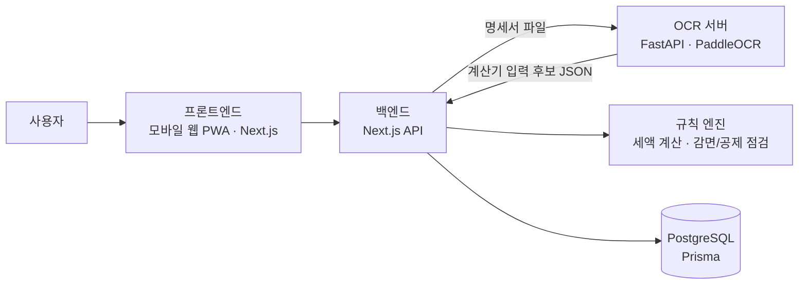

# OTP: 사회초년생을 위한 세금계산 서비스

GDGOC OTP 프로젝트 저장소입니다. 프론트엔드, 백엔드, OCR, QA가 한 저장소에서 협업합니다.

## 주제

1. **사회초년생이 헷갈려할 정보 제공:** 청년 혜택, 용어 풀이, 첫해 중도입사 등
2. **상황 진단·혜택 체크 중심:** 단순 실수령 계산기는 경쟁력이 없으므로, 사회초년생의 상황을 진단하고 받을 수 있는 혜택을 점검하는 데 집중
3. **세액은 규칙 기반:** 세액은 틀리면 안 되므로 AI가 아니라 규칙 기반 계산기가 계산
4. **AI는 입력 보조:** 사용자가 올린 급여명세서(PDF/사진)에서 계산기 입력값을 채워 줌. 사용자가 확인한 값만 계산에 사용

## 서비스 구조

1. 사용자가 급여명세서를 올리면 백엔드가 OCR 서버로 보냅니다.
2. OCR 서버가 지급·공제 항목, 입사일 후보, 귀속월을 뽑고 개인정보를 가린 뒤 JSON으로 돌려줍니다.
3. 프론트가 확인 화면에서 사용자에게 값을 확인받습니다.
4. 백엔드가 확정된 값을 저장하고, 규칙 엔진이 세액 계산과 혜택 점검을 합니다.

## 폴더 구조와 담당

| 폴더 | 내용 | 담당 | 상태 |
| --- | --- | --- | --- |
| [`frontend/`](frontend/) | 모바일 웹 화면 | 프론트 | - |
| [`backend/`](backend/) | API, DB, 규칙 엔진 연동 | 백엔드 | - |
| [`ocr-server/`](ocr-server/) | 급여명세서 OCR API 서버 | OCR | 1차 구현 완료 (QA테스트 전까지 완료) |
| [`qa/`](qa/) | 테스트 케이스, 평가셋 | QA | - |
| [`docs/`](docs/) | 팀 사이의 약속 (API 명세, 구조 문서) | 관련 팀 공동 | OCR API 초안 |

각 폴더는 독립적으로 실행합니다. 실행 방법은 폴더별 README를 참고하세요.

## 팀 사이 연결 지점

팀끼리 맞춰야 하는 값은 코드가 아니라 문서로 먼저 정하고, 바꿀 때는 양쪽이 함께 리뷰합니다.

| 연결 | 약속 문서 | 맞출 내용 |
| --- | --- | --- |
| 백엔드 ↔ OCR | [docs/api/ocr-api.md](docs/api/ocr-api.md) | 요청·응답 형식, 에러 코드, 타임아웃, 인증 키 |
| 프론트 ↔ 백엔드 | docs/api/backend-api.md (작성 예정) | 화면별 API, 확인 화면 데이터 |
| OCR ↔ 계산기 | [`ocr-server/ocr/rates.json`](ocr-server/ocr/rates.json) ↔ `TaxRuleVersion` | 연도별 4대보험·세율 |
| QA ↔ 전체 | [qa/](qa/) | 테스트 케이스, 평가셋, 목표 수치 |

## 협업 규칙 (요약)

- `main`에 직접 올리지 않고 **브랜치 → PR → 리뷰 1명 이상** 후 합칩니다.
- 브랜치 이름: `파트/작업` (예: `ocr/join-date`, `be/upload-api`, `fe/confirm-screen`)
- 커밋 메시지: `[파트] 내용` (예: `[OCR] 입사일 추출 추가`)
- 다른 팀 폴더나 `docs/`를 고치면 해당 팀을 리뷰어로 지정합니다.
- **실제 급여명세서, API 키, `.env` 파일은 올리지 않습니다.**

자세한 내용은 [CONTRIBUTING.md](CONTRIBUTING.md)를 참고하세요.
