# 청년 세금 관리 앱 — MVP 구조 초안

20개 테이블로 9개 MVP 기능을 구성한다. 프로필은 User에 합치고, 경비 카테고리는 enum, 태그·대상 유형은 배열로 둔다. 신고서 작성·제출 관련 테이블은 없다.

## ERD

PK/FK와 카디널리티 중심이다. 모든 테이블의 공통 필드 `createdAt`, `updatedAt`, `deletedAt`과 상세 컬럼은 `prisma/schema.prisma`에 있다. Simulation의 taxYear는 규칙 버전과의 복합 FK에 포함된다.

```mermaid
erDiagram
    User ||--o{ ConsentHistory : consents
    User ||--o{ Diagnosis : diagnoses
    User ||--o{ IncomeSource : sources
    User ||--o{ IncomeRecord : incomes
    User ||--o{ Expense : expenses
    User ||--o{ Simulation : simulations
    User ||--o{ NotificationPreference : notifications
    User ||--o{ ChecklistProgress : progress
    User ||--o{ Bookmark : bookmarks
    IncomeSource ||--o{ IncomeRecord : owns
    IncomeSource o|--o{ Expense : optional_source
    Expense ||--o{ Evidence : files
    Schedule ||--o{ NotificationPreference : settings
    ChecklistTemplate ||--o{ ChecklistItem : items
    ChecklistItem ||--o{ ChecklistProgress : statuses
    Article ||--o{ Bookmark : bookmarked
    TaxRuleVersion ||--o{ Diagnosis : guide_rules
    TaxRuleVersion ||--o{ Simulation : calculation_rules
    TaxRuleVersion ||--o{ IncomeTaxBracket : brackets
    TaxRuleVersion ||--o{ ExpenseRateRule : industry_rates
    TaxRuleVersion ||--o| HealthInsuranceRule : insurance
    TaxRuleVersion ||--o| DependentCriteria : dependent_rules
    User {
        String id PK
    }
    ConsentHistory {
        String id PK
        String userId FK
    }
    Diagnosis {
        String id PK
        String userId FK
        String taxRuleVersionId FK
    }
    IncomeSource {
        String id PK
        String userId FK
    }
    IncomeRecord {
        String id PK
        String userId FK
        String sourceId FK
    }
    Expense {
        String id PK
        String userId FK
        String sourceId FK
    }
    Evidence {
        String id PK
        String expenseId FK
        String userId FK
    }
    Simulation {
        String id PK
        String userId FK
        Int taxYear FK
        String taxRuleVersionId FK
    }
    Schedule {
        String id PK
    }
    NotificationPreference {
        String id PK
        String userId FK
        String scheduleId FK
    }
    ChecklistTemplate {
        String id PK
    }
    ChecklistItem {
        String id PK
        String templateId FK
    }
    ChecklistProgress {
        String id PK
        String userId FK
        String itemId FK
    }
    Article {
        String id PK
    }
    Bookmark {
        String id PK
        String userId FK
        String articleId FK
    }
    TaxRuleVersion {
        String id PK
    }
    IncomeTaxBracket {
        String id PK
        String taxRuleVersionId FK
    }
    ExpenseRateRule {
        String id PK
        String taxRuleVersionId FK
    }
    HealthInsuranceRule {
        String id PK
        String taxRuleVersionId FK
    }
    DependentCriteria {
        String id PK
        String taxRuleVersionId FK
    }
```

## 테이블 설명

| 테이블 | 연결 기능 | 목적과 핵심 컬럼 | 애플리케이션 암호화 |
|---|---|---|---|
| User | 1 | 인증 공급자 식별자 `authSubject`, 직업 `occupation`, 사업자 유형 `businessType`, 대표 `industryCode`, 개업일 `businessStartedOn`. 미등록 여부는 businessType 하나로 표현한다. | `contactCiphertext` 필수: 선택 닉네임/이메일 |
| ConsentHistory | 1 | 목적별 `purpose`, `termsVersion`, `agreedAt`, `withdrawnAt`. 재동의는 새 행이다. | 없음: 동의 증적이며 접근 제한 |
| Diagnosis | 2 | `questionnaireVersion`, `answersCiphertext`, 가이드 `guide`, 근로자성 의심 `suspectedDisguisedEmployment`, `taxRuleVersionId`, `evaluatedAt`, `isEstimate`. | `answersCiphertext` 필수 |
| IncomeSource | 3 | 수입 채널과 지급처의 묶음. `type`은 급여/용역/애드센스/광고/후원·슈퍼챗/MCN/상품판매. 같은 유형에도 지급처별 여러 행 허용. | `detailsCiphertext` 필수: 표시명·지급처명 |
| IncomeRecord | 3 | `receivedOn`, 사용자가 확인한 `treatment`, `currency`, `exchangeRateToKrw`, 환율 기준일/출처, `withholdingApplied`, 원금·원천징수액 묶음. | `amountsCiphertext` 필수 |
| Expense | 4 | `category`, `spentOn`, 통화/환율/기준일/출처, 금액. `sourceId`는 선택이며 실제 납세상 경비 인정 여부를 뜻하지 않는다. | `amountsCiphertext` 필수 |
| Evidence | 4 | 경비당 여러 증빙. `s3Key`, `type`, `mimeType`, `byteSize`. 파일 본문/URL/원본 파일명은 저장하지 않는다. | DB 암호화 대상 없음. S3 객체는 별도 암호화 |
| Simulation | 5 | `taxYear`, `taxRuleVersionId`, `calculatorVersion`, `calculatedAt`, `isEstimate`, 입력/결과 스냅샷, `expenseRateMethod`, `dependentRisk`. | `inputCiphertext`, `resultCiphertext` 필수 |
| Schedule | 6 | 연도·일정 종류별 `dueOn`, 대상 직업/과세유형, 안내, 검증 출처. 사업자등록은 상대 시점 안내다. | 없음 |
| NotificationPreference | 6 | 사용자/일정별 `enabled`, `daysBefore`, `localHour`, 필요시 사용자 지정 `customReminderOn`. | 없음 |
| ChecklistTemplate | 7 | `taxYear`, `type`, `title`. 근로/프리랜서/크리에이터/N잡/부가세 템플릿. | 없음 |
| ChecklistItem | 7 | 템플릿 내 안정적 `key`, `title`, `description`, `sortOrder`. | 없음 |
| ChecklistProgress | 7 | 사용자/항목별 `status`, `completedAt`. 행이 없으면 TODO. | 없음 |
| Article | 8 | `slug`, `title`, `body`, `tags`, `targetOccupations`, `publishedAt`. 공개 가이드만 저장. | 없음 |
| Bookmark | 8 | 사용자와 아티클의 연결. | 없음 |
| TaxRuleVersion | 2·5·9 | `taxYear`, `version`, `status`, `sourceUrls`, `verifiedAt`, 공통 규칙 `parameters`. 한 버전이 해당 연도의 일관된 규칙 묶음이다. | 없음: 공개 마스터 |
| IncomeTaxBracket | 5·9 | 누진구간 하한/상한, `rate`, `progressiveDeductionKrw`. | 없음: 공개 마스터 |
| ExpenseRateRule | 5·9 | 업종별 전년도 수입/신규 사업/기장 기준, 단순·기준경비율, 예외 `eligibilityParameters`. | 없음: 공개 마스터 |
| HealthInsuranceRule | 5·9 | 건보 전체율, 근로자 부담 비율, 건보 대비 장기요양 비율과 추가 기준. | 없음: 공개 마스터 |
| DependentCriteria | 5·9 | 연소득, 미등록 사업소득, 재산 과표 기준과 등록 여부·예외·경고 기준. | 없음: 공개 마스터 |

## 핵심 설계 결정

- **프로필**: 직업은 직장인/프리랜서/크리에이터/N잡 enum. businessType=UNREGISTERED/SIMPLIFIED/GENERAL로 등록 여부와 유형을 함께 표현한다. 대표 업종 하나만 저장한다.
- **자가진단**: 설문 테이블을 별도로 만들지 않고 질문 버전과 선택지 응답 묶음을 보관한다. 판정은 가이드이며 근로자성 의심 플래그를 별도로 둔다. 규칙 버전과 평가 시각을 함께 저장한다.
- **수입**: 수입원과 지급처를 IncomeSource에 합치고 실제 수입은 IncomeRecord로 여러 번 기록한다. 세전 금액과 원천징수액을 구분한다. 소득 구분은 수입원 종류로 자동 확정하지 않는다.
- **환율**: 거래마다 통화·원화 환율·환율 기준일·출처를 저장한다. 별도 환율 마스터는 만들지 않는다. KRW의 환율은 1이다.
- **경비**: 수입원 연결은 선택이다. 한 경비에 증빙 여러 개를 연결할 수 있다. 증빙은 비공개 S3 key만 DB에 저장한다.
- **시뮬레이션**: 귀속연도, 규칙 버전, 계산기 버전, 계산 시각, 예상치 표시를 저장한다. 실행마다 새 행을 만들고 입력/결과 스냅샷을 보관한다.
- **계산 입력**: 근로·사업소득, 업종별 전년도 수입, 공제, 주요 경비, 연말정산 후 기납부세액, 피부양자 판단에 필요한 소득·재산 정보를 입력 스냅샷에 둔다. 모르는 값은 0으로 처리하지 않는다.
- **계산 결과**: 예상 국세/지방세/합계, 기납부세액, 예상 환급·추가납부액, 업종별 경비율 판정, 피부양자 위험 사유를 결과 스냅샷에 둔다. 환급·추가납부 차액은 `예상세액−기납부액`이며 음수가 환급이다. 근로 기납부와 3.3% 국세·지방세를 구분해 중복 합산을 피한다.
- **기준 마스터**: 연도·버전별 한 묶음이다. 누진구간·업종별 경비율·건보율·피부양자 기준은 테이블로, 추가 공제/예외/진단 기준은 버전 있는 parameters로 둔다. 운영 검증 후에는 수정하지 않고 새 버전을 만든다. 세율 구간은 `[하한, 상한)`이다.
- **일정**: Schedule.taxYear는 일정이 발생하는 연도이고 Simulation/ChecklistTemplate.taxYear는 소득 귀속연도다. 등록 필요 시점은 상대 안내와 사용자 지정 알림 날짜로 단순화한다. 일정은 의무 확정이 아닌 점검 안내다.
- **알림**: 사용자·일정별 켜기/끄기, 며칠 전, 시각만 저장한다. MVP는 Asia/Seoul 기준 앱 내부 알림이며 발송 이력·기기 토큰 테이블은 만들지 않는다.
- **체크리스트**: 연도·유형별 템플릿과 항목, 사용자별 진행 상태로 나눈다. 진행 행이 없으면 TODO다.
- **콘텐츠**: 아티클과 북마크만 둔다. 태그·대상 직업 연결 테이블은 만들지 않는다.

## 금액과 암호화

공개 기준금액은 `Decimal(20,0)`, 비율은 `Decimal(12,10)`, 환율은 `Decimal(24,10)`이다. Float는 쓰지 않는다.

개인 금액은 **논리 타입 Decimal → 문자열 직렬화 → 애플리케이션 암호화 → Bytes 저장**으로 설계했다. 일반 암호문을 Decimal 컬럼에 저장할 수 없으므로 개인 금액의 실제 저장 타입만 Bytes다. 평문 Decimal 컬럼을 중복으로 두지 않는다. 복호화 후 Decimal로 계산하며 JS Number로 변환하지 않는다. 암호화 구현 자체는 이 설계에 포함하지 않는다.

| 암호화 컬럼 | 포함할 값 |
|---|---|
| User.contactCiphertext | 선택 닉네임·이메일 |
| IncomeSource.detailsCiphertext | 표시명·지급처명 |
| Diagnosis.answersCiphertext | 질문 ID와 선택지 ID |
| IncomeRecord.amountsCiphertext | 원통화 세전금액, 원천징수 합계·국세·지방세. Decimal(20,4) 문자열 |
| Expense.amountsCiphertext | 원통화 금액. Decimal(20,4) 문자열 |
| Simulation.inputCiphertext | 실행 당시 소득·경비·공제·기납부·건보 판단 입력 |
| Simulation.resultCiphertext | 원 단위 예상세액·환급/추가납부액과 계산 근거. Decimal(20,0) 문자열 |

암호문에는 키 버전·nonce·인증 태그를 포함한다. 금액 조회·집계는 사용자 권한 확인 후 애플리케이션에서 복호화해 처리한다. payload는 정해진 키만 허용하며 금지 식별자 저장소로 쓰지 않는다.

홈택스 ID/비밀번호, 공동인증서, 주민등록번호 전체, 계좌번호 전체 필드는 만들지 않았다. 증빙 파일에 해당 정보가 있으면 업로드 전에 마스킹해야 한다. S3 key에는 개인정보를 넣지 않는다.

## 동의·키·삭제

- 동의는 목적, 약관 버전, 동의 시각, 실제 철회 시각을 별도 이력으로 보관한다. 재동의는 새 행이며 약관 갱신을 철회로 기록하지 않는다.
- 모든 id는 cuid다. FK는 Restrict, 모든 테이블에 soft delete 필드를 둔다. 조회 시 본인 소유권과 부모/자식의 삭제 여부를 확인한다. soft delete와 실제 개인정보 파기는 구분한다.
- 수입·경비는 `(sourceId,userId)`, 증빙은 `(expenseId,userId)` 복합 FK로 타 사용자 기록 연결을 막는다.
- 사용자/북마크, 사용자/일정 설정, 사용자/체크항목은 unique다. 삭제 후 다시 사용할 때 기존 행을 복구한다.
- 규칙은 `(taxYear,version)`, 경비율은 `(taxRuleVersionId,industryCode)`, 체크리스트는 `(taxYear,type)`으로 unique다. 주요 사용자·날짜 조회와 FK에 인덱스를 둔다.
- 예상치 강제, 암호화 전 금액 검증, 마스터 불변성, 필수 동의 확인은 구현 시 적용할 규칙이다. 이 산출물은 구조 설계이며 API·암호화·계산 로직을 구현하지 않는다.

## 시드 예시

`prisma/seed.ts`는 2026년 더미 세율·경비율·건보·피부양자 기준과 체크리스트 예시다. 모든 수치는 **TODO: 공식 출처로 검증 필요**이며 DRAFT로 둔다. 실제 계산에 사용할 수 없다. 검증된 날짜가 없으므로 일정 더미는 넣지 않았다.

타입 매핑은 [Prisma PostgreSQL 공식 문서](https://www.prisma.io/docs/orm/v6/overview/databases/postgresql)를 참고했다.

## MVP 이후 확장 포인트

- 마이데이터 연동: 기관 연결·연동 동의·외부 거래 식별자.
- 가족 공유: 가족 그룹·명시적 공유 동의·접근 권한.
- 세무사 광고형 디렉터리: 전문가 프로필·광고 표시·노출 계약.

위 확장 테이블은 현재 스키마에 넣지 않았다.
