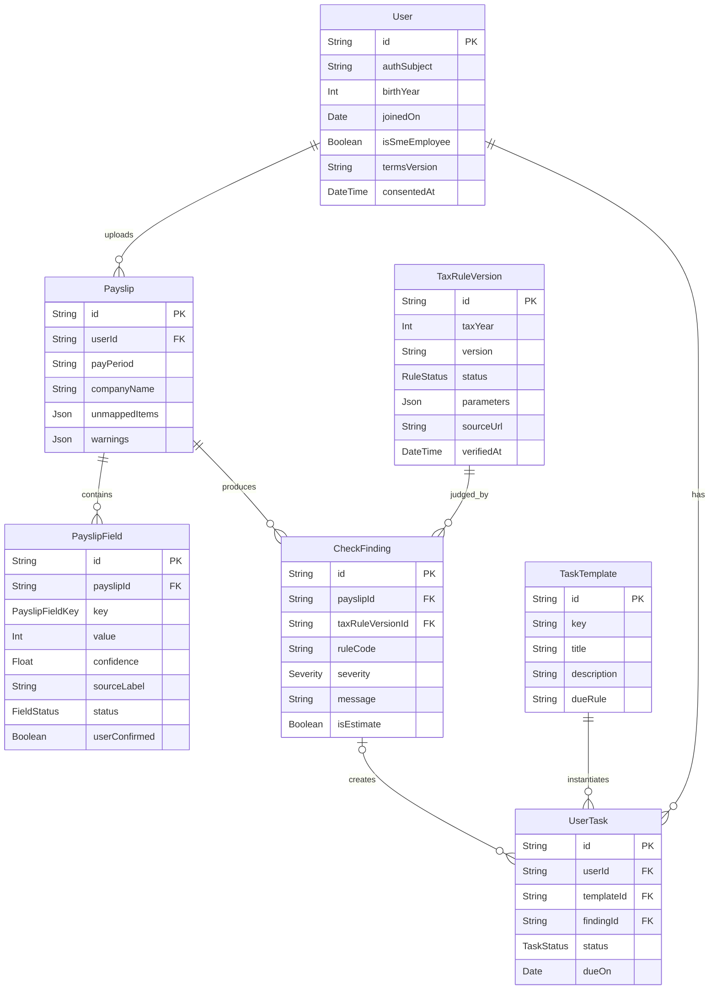

# 사회초년생 급여명세서 점검 앱 — 데모용 MVP 구조

7개 테이블로 "급여명세서 업로드 → 확인 → 규칙 점검 → 확인할 일" 흐름을 구성한다. 상세 컬럼과 제약은 `prisma/schema.prisma`에 있고, 그림은 `docs/MEETING_MATERIAL/MVP/FOR_Draw_Io/erd-mvp.drawio`에 있다. 기존 20개 테이블 설계(프리랜서·크리에이터·N잡러 중심)는 `docs/ARCHIVE/FULL_20_TABLES/erd-full-20-tables.md`에 보관했다.

## ERD

## 테이블 설명

| 테이블 | 흐름에서의 역할 | 핵심 컬럼 |
|---|---|---|
| User | 가입, 동의, 감면 점검 입력값 | 인증 식별자 `authSubject`, `birthYear`, 입사일 `joinedOn`, 중소기업 여부 `isSmeEmployee`, 동의 `termsVersion`·`consentedAt` |
| Payslip | 업로드한 명세서 1건 | 귀속 월 `payPeriod`("2026-03"), `companyName`, 표준화하지 못한 항목 `unmappedItems`, 검증 경고 `warnings` |
| PayslipField | 명세서의 표준 필드 1칸 | `key`(14개 enum), 원 단위 정수 `value`(없으면 null), `confidence`, 원문 항목명 `sourceLabel`, `status`(OK/NEEDS_REVIEW/MISSING), 사용자 확인 여부 `userConfirmed` |
| TaxRuleVersion | 점검에 쓰는 규칙 버전 | `taxYear`, `version`, `status`(DRAFT/VERIFIED), `parameters`(JSON), `sourceUrl`, `verifiedAt` |
| CheckFinding | 점검 결과 1건 | `ruleCode`, `severity`(INFO/WARNING/CRITICAL), `message`, `isEstimate`(기본 true) |
| TaskTemplate | 할 일 원본 | `key`(unique), `title`, `description`, 상대 기한 규칙 `dueRule` |
| UserTask | 사용자별 할 일 | `status`(TODO/DONE/NOT_APPLICABLE), `dueOn`, 점검 결과에서 생겼다면 `findingId` |

표준 필드 14개: `base_salary`, `meal_allowance`, `car_allowance`, `overtime_pay`, `bonus`, `payment_total`, `national_pension`, `health_insurance`, `long_term_care`, `employment_insurance`, `income_tax`, `local_income_tax`, `deduction_total`, `net_pay`. 급여명세서 OCR 파트 명세의 필드와 같다.

## 핵심 설계 결정

- **원본 파일은 저장하지 않는다.** OCR 파트 명세에 따라 추출 직후 원본을 삭제하므로 파일 저장소 테이블이 없다. 추출된 항목과 금액만 저장한다.
- **명세서 필드는 열이 아니라 행이다.** 14개 필드를 컬럼으로 두지 않고 `key`로 구분한다. 신뢰도와 상태를 필드별로 담을 수 있고, 필드가 늘어도 컬럼이 늘지 않는다. 같은 명세서에서 같은 `key`는 하나만 허용한다.
- **사용자가 확인한 값만 점검에 쓴다.** `userConfirmed`가 true인 필드만 규칙 엔진에 전달한다.
- **금액은 월 기준 정수 원이다.** 읽지 못한 값은 0이 아니라 null이다.
- **점검 결과는 항상 예상치 안내다.** `isEstimate` 기본값이 true이며, 확정 판정처럼 보여주지 않는다. 신고·신청은 사용자가 회사나 홈택스에서 직접 한다.
- **점검 결과가 할 일을 만든다.** CheckFinding에서 UserTask가 생길 수 있다(연결은 선택). 일반 입사 후 할 일은 `findingId`가 null이다. 사용자는 같은 할 일 템플릿을 한 번만 받는다.
- **규칙은 버전으로 관리한다.** 점검 결과는 어떤 규칙 버전으로 판단했는지 기록한다. 규칙 수치는 검증 전까지 DRAFT다.

## 데모 단순화 (실서비스 전환 시 다시 넣을 것)

| 뺀 것 | 기존 20개 테이블 설계에서의 처리 | 실서비스에서 필요한 이유 |
|---|---|---|
| 개인 데이터 암호화 | 금액·이름 등을 앱 레벨 암호화 | 금액과 회사명이 평문으로 저장됨 |
| soft delete(`deletedAt`) | 모든 테이블에 적용 | 삭제와 개인정보 파기 정책 |
| 동의 이력 테이블 | 목적·약관 버전별로 철회·재동의까지 기록 | 지금은 `User`의 한 쌍만 있어 철회 이력이 남지 않음 |
| 복합 FK로 타 사용자 연결 방지 | 소유권 검증 | 조회 시 본인 소유 확인은 애플리케이션 코드로 해야 함 |

## 팀 결정이 필요한 것

- `User`의 `birthYear`, `joinedOn`, `isSmeEmployee`를 사용자가 직접 입력할지, 명세서에서 추정할지. 모두 nullable로 열어 뒀다. 중소기업 여부는 명세서만으로는 알기 어렵다.
- `TaskTemplate.dueRule`의 형식. 지금은 문자열이며 "입사 월 다음 달 말일" 같은 상대 기한을 어떻게 표현할지 미정이다.
- `TaxRuleVersion.parameters`의 구조. 감면 요건이 늘면 JSON 하나로는 한계가 있어 별도 테이블 분리를 검토한다.
- 월 단위 명세서를 연 단위 계산(N잡러 확장 시 시뮬레이션)과 어떻게 연결할지.

## 시드

`prisma/seed.ts`는 `TaxRuleVersion` 더미 1개와 `TaskTemplate` 2개(감면 신청서, 부양가족 제출)만 넣는다. **모든 값이 TODO: 공식 출처로 검증 필요**이며 DRAFT로 둔다. 실제 안내에 사용할 수 없다.

## 후속 확장 (현재 스키마에 없음)

- **N잡러:** 부업 수입 기록, 근로+부업 합산 시뮬레이션. 명세서의 `income_tax`와 `local_income_tax`가 기납부세액 입력이 된다.
- **인플루언서:** 플랫폼 수입, 통화·환율 기록, 수입원 관리, 경비·증빙.
- 위 확장 테이블의 설계는 `docs/ARCHIVE/FULL_20_TABLES/erd-full-20-tables.md`와 `docs/ARCHIVE/FULL_20_TABLES/schema-full-20-tables.prisma.txt`를 참고한다.
